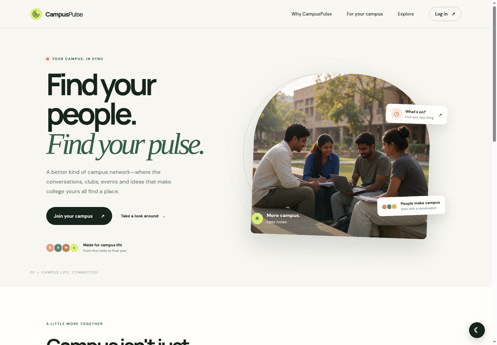
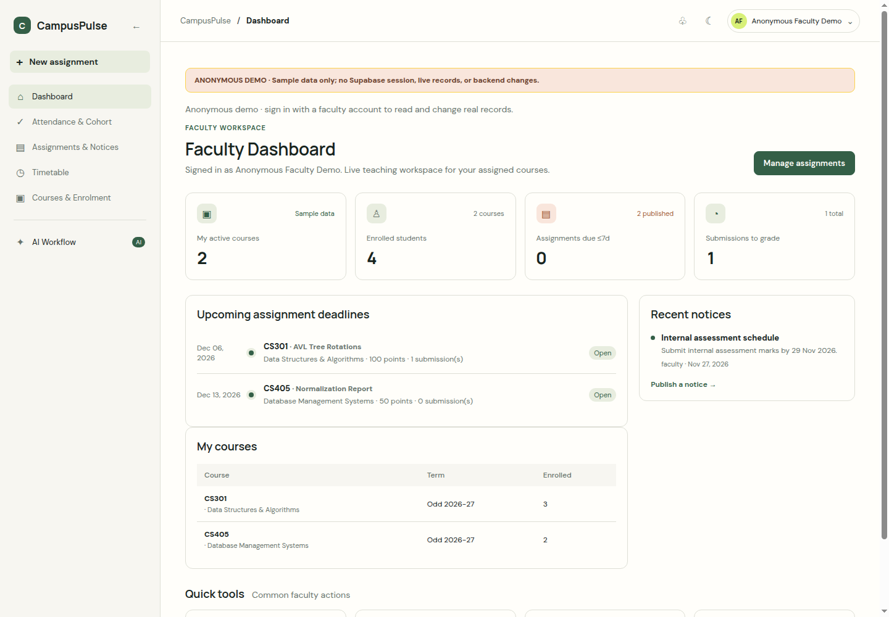
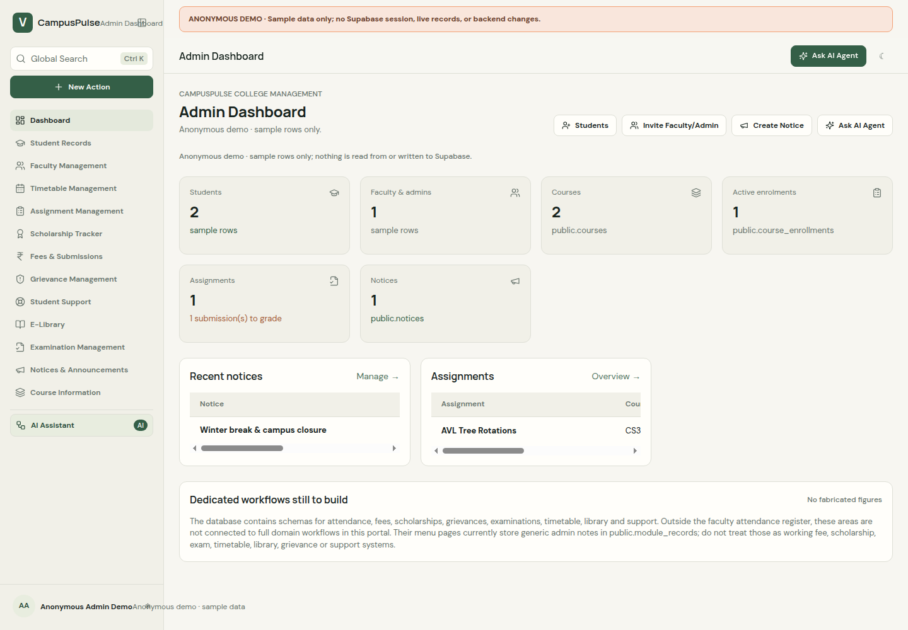
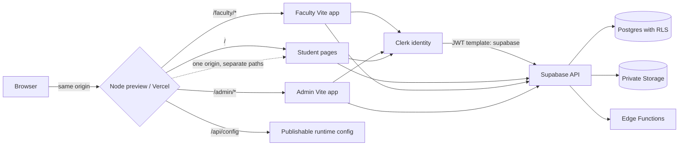
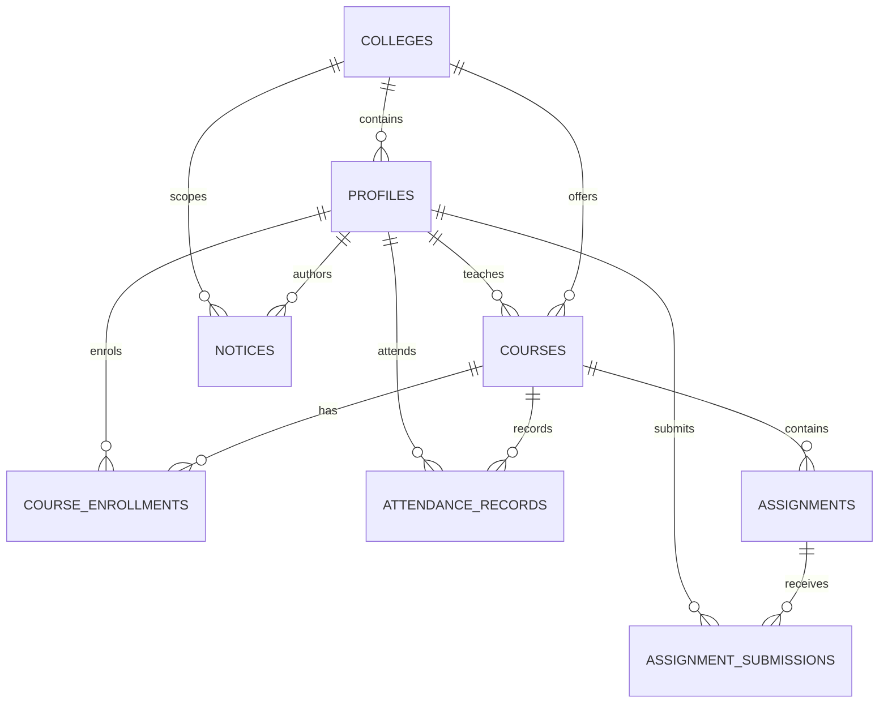

# CampusPulse

**A college-management platform with Student, Faculty, and Admin portals served from one origin.** The Student experience is static-first; Faculty and Admin are separate Vite applications; Supabase provides the data layer and Clerk provides identity.



## Run all three portals locally

Requirements: Git, Node.js 20 or newer, and npm. From a fresh clone, use the repository root for the combined preview:

```bash
git clone https://github.com/annms1876-glitch/full-stack-college-management-.git
cd full-stack-college-management-
npm ci
npm run preview
```

The preview command builds the Student, Faculty, and Admin outputs, then serves them from the same local server. Open **<http://127.0.0.1:3000/>**. The home page and both staff portals share one origin:

- Student home: `/`
- Faculty portal: `/faculty/`
- Admin portal: `/admin/`

For another local port, set `PORT=3001 npm run preview`. The server binds to loopback by default; use `HOST=0.0.0.0` only when you intentionally need LAN access. The first build installs the Faculty and Admin lockfile-pinned dependencies.

The root preview is the recommended workflow when testing the home-page portal links. The individual Vite servers on ports 3001 and 3002 are useful for isolated UI development, but they are separate origins and do not reproduce the deployed route layout.

## What the portals currently do

| Portal or workflow | Implemented behavior | Important boundary |
|---|---|---|
| Student | Static campus pages, with live data operations for enrolled courses, assignments, submissions, and signed file downloads. Some interactions remain presentation-only. | Sign-in and persisted data need a configured Clerk/Supabase project. |
| Faculty | Live views and operations for assigned courses, enrolments, notices, assignments, submissions, grading, and attendance. | Access is checked using the trusted profile role and database row-level security (RLS). |
| Admin core | Live profile, course, enrolment, notice, and role-management operations; assignment and submission oversight is read-only. | Role changes apply to already provisioned members in the administrator’s college. |
| Admin modules | The schema includes timetable, scholarship, fee, grievance, support, library, and examination tables. | These Admin menu screens currently store generic `module_records` notes; they are not full workflows for those domains. |
| AI assistant | Faculty/Admin can request advisory text from the configured `ai-assistant` Edge Function. | It does not execute a multi-agent workflow or modify, approve, or publish records. |

A menu item or database table does not mean the corresponding workflow is complete. See [frontend/backend wiring](docs/backend/frontend-wiring.md) for the implemented data calls and [architecture notes](docs/architecture.md) for current boundaries.

## Screenshots

These screenshots show the interface served by the combined local preview. The Faculty and Admin captures use the app’s explicitly labelled anonymous sample view; they demonstrate layout only and do not authenticate, read Supabase, or save changes.





## Architecture

The Vercel project is configured at the repository root so its build emits all three portals into one output directory. The same route layout is used by `npm run preview` locally.



The database’s principal coursework relationships are:



For additional community, study, and policy relationships, see the full [architecture and ERD document](docs/architecture.md).

## Configure live sign-in and data

The app expects these **publishable/browser-safe** values at runtime:

```text
CLERK_PUBLISHABLE_KEY
SUPABASE_URL
SUPABASE_PUBLISHABLE_KEY
```

Set them in the local process environment or in the Vercel project’s Production and Preview environment settings, then redeploy. The `/api/config` response contains only these publishable values. Never put a Clerk secret key, Supabase service-role key, database password, or AI provider key in browser code or a `VITE_*` variable.

Before live access works, Clerk must issue a Supabase-compatible JWT using the `supabase` template and the Supabase project must verify it. Each Clerk user also needs a trusted `public.profiles` row linked through `clerk_user_id` with the correct role and college. This repository does not provide automatic profile provisioning. Apply and review the SQL migrations and configure the Edge Functions and their server-side secrets separately. Follow [Clerk/Supabase setup](docs/backend/clerk-supabase-auth.md) and [testing guidance](docs/backend/testing.md); use a disposable Supabase project before production data.

Without those external settings, portal URLs can still be tested on the shared origin, but protected data operations are not live. Do not treat the anonymous sample view as a production sign-in path.

## Build, test, and deploy

Run from the repository root:

```bash
npm ci
npm test
npm run scan:secrets
npm run build:vercel
```

`npm test` runs the API and security regression suites. `scan:secrets` is a heuristic scan, not a security certification. `build:vercel` outputs the Student site plus `/faculty/` and `/admin/` bundles under `campuspulse-frontend/dist/`.

For Vercel, import the GitHub repository as one project and keep **Root Directory** at the repository root. The checked-in `vercel.json` selects the combined build and route rewrites. Do not deploy only the nested Student folder if all three portals need the same domain. The default `*.vercel.app` deployment hostname is sufficient for one-origin routing; a custom domain is optional. Vercel hosting does not deploy or configure your Clerk/Supabase project or database migrations.

## Open-source patterns reviewed

Two comparable repositories informed the route and authorization review: [Pranayy1/college-management-system](https://github.com/Pranayy1/college-management-system) uses role-oriented protected routes and backend authorization checks, while [SmitBorsadiya/CollegeERP](https://github.com/SmitBorsadiya/CollegeERP) makes Admin and Faculty paths explicit. CampusPulse follows the same core separation: role is read from a trusted profile, routes are role-specific, and RLS remains the data-access boundary. The single-origin local preview now mirrors the root Vercel path layout instead of asking developers to validate home-page links across unrelated servers.

These projects are reference implementations, not proof that their security or completeness is suitable for this application. CampusPulse-specific remaining work is listed above and in the architecture document.

## Repository map

```text
campuspulse-frontend/
  public/                  Student pages, auth, and browser data operations
  faculty-dashboard/       Faculty Vite app and data layer
  server.js                Combined local preview and runtime config endpoint
campuspulse-admin-dashboard/
  src/                     Admin Vite app and data layer
shared/auth/               Clerk-to-Supabase JWT adapter
supabase/
  migrations/              Database schema, RLS, Storage, and policy changes
  functions/               Server-side Edge Functions
docs/                      Setup, architecture, screenshots, and security notes
tests/                     Node-based API and security regression tests
scripts/                   Build, scan, and maintenance scripts
```

## Technology and attribution

JavaScript, HTML, CSS, Node.js, Vite, Tailwind CSS, Clerk, Supabase Postgres/RLS, Storage, and Edge Functions. Third-party package manifests and lockfiles are in the repository. External fonts or other third-party assets may have separate terms; review them before reuse or redistribution. The earlier source history does not include a complete asset/template attribution record, so add the team’s required credits before submission.
