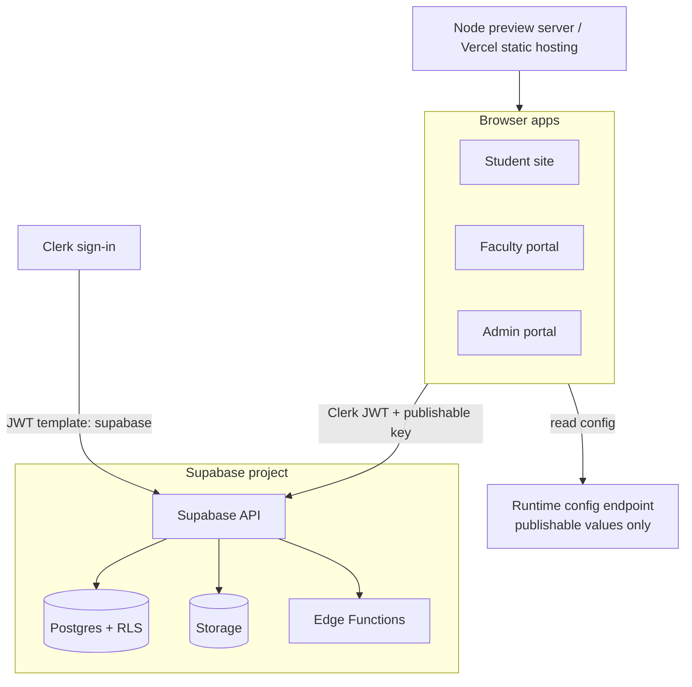
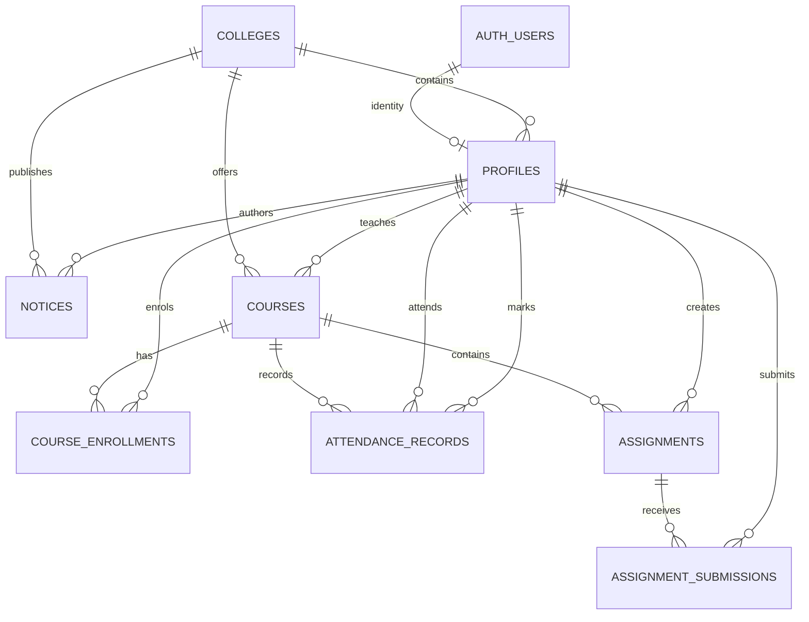
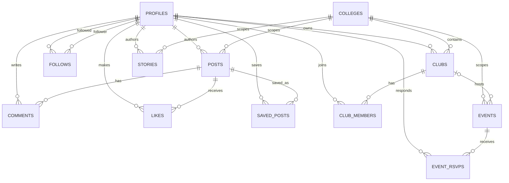
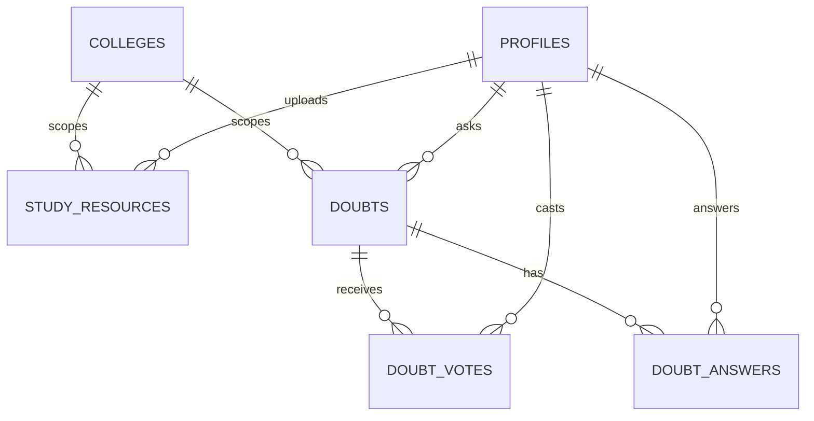

# CampusPulse architecture and ERD

This document describes the code and SQL migrations in this repository. It is a map of the implemented structure, not a claim that every screen is production-ready. Database tables can exist before a matching screen is finished.

## System architecture

### What each part does

- **Student site:** Static pages served locally by `campuspulse-frontend/server.js`. The root Vercel build packages it together with both portals.
- **Faculty and Admin portals:** Separate Vite single-page apps. Their local dev servers run on ports 3001 and 3002. The shared build places them under `/faculty/` and `/admin/` on the same origin.
- **Clerk:** Owns browser sign-in. The shared adapter in `shared/auth/clerk-supabase.js` requests a Clerk JWT using the JWT template named `supabase` and passes it to the Supabase client.
- **Supabase:** Stores relational application data in Postgres, checks Row-Level Security (RLS), and stores uploaded files. The browser receives publishable keys only; it must never receive a service-role key.
- **Edge Functions:** `ai-assistant`, `invite-user`, `grant-role`, and `get-signed-url` perform privileged or server-side work. They need separate deployment and server-side secrets.

### Identity and access caveat

The SQL migration `202611260016_clerk_identity_compatibility.sql` adds `profiles.clerk_user_id` and maps a Clerk JWT subject to the existing internal profile UUID. The UI looks up that profile and its trusted role. This repository does **not** include a Clerk webhook or other automatic profile-provisioning service. A Clerk user without a matching profile cannot use protected data. Clerk's JWT verification settings, user/profile provisioning, Supabase project secrets, and migrations must be configured outside this repository before live sign-in can work.

## ERD

The diagrams show the main foreign-key relationships declared by the SQL migrations. The main coursework model is shown first, followed by community and study relationships. Other academic/admin and audit tables are listed below. See `supabase/migrations/` for full columns, constraints, indexes, and policies.

Other migration-defined tables include `attendance_records`, `grievances`, `scholarships`, `fee_invoices`, `examinations`, `timetable_entries`, `library_books`, `support_tickets`, and `module_records`. Operational tables include `notifications`, `reports`, `rate_limits`, and `role_change_audit`. Their foreign keys, policies, and constraints are in the migrations; some screens for these modules remain illustrative.

### Main relationship rules

- A college groups its profiles, courses, notices, and campus content.
- A course belongs to one college and is taught by one faculty profile. Students join courses through `course_enrollments`, a many-to-many link.
- Attendance rows belong to a course and an enrolled student, and record the staff profile who marked the status. The unique course/student/date key allows one register row per class date. Migration `202611260017_attendance_enrolment_scope.sql` scopes reads/writes to the profile's college and requires active enrolment plus course-staff/admin authority for writes.
- Assignments belong to courses. A student submits at most one submission row per assignment; the row can carry a file reference, status, grade, and feedback.
- Posts, clubs, events, study resources, and questions connect to a college and/or profile. Join tables such as `likes`, `club_members`, and `event_rsvps` represent many-to-many relationships.
- The Faculty portal now has a live attendance register. Other academic/admin tables such as grievances, fees, timetable, scholarships, exams, support, and library are present in SQL, but their Admin menu pages currently save generic `module_records` notes rather than full domain workflows.
- Composite keys, unique constraints, checks, and foreign keys are omitted from the drawing for readability. They remain defined in the migrations.

## Main code paths

| Need | Start here |
|---|---|
| Student pages and browser data calls | `campuspulse-frontend/public/` |
| Faculty screens and Supabase operations | `campuspulse-frontend/faculty-dashboard/src/` |
| Admin screens and Supabase operations | `campuspulse-admin-dashboard/src/` |
| Shared Clerk-to-Supabase token adapter | `shared/auth/clerk-supabase.js` |
| Database tables and RLS | `supabase/migrations/` |
| Server-side endpoints | `supabase/functions/` |
| Node regression tests | `tests/` |

For the simplest local preview steps, see the [root README](../README.md#run-a-local-preview). For Clerk/Supabase configuration, see [Clerk and Supabase setup](backend/clerk-supabase-auth.md).
