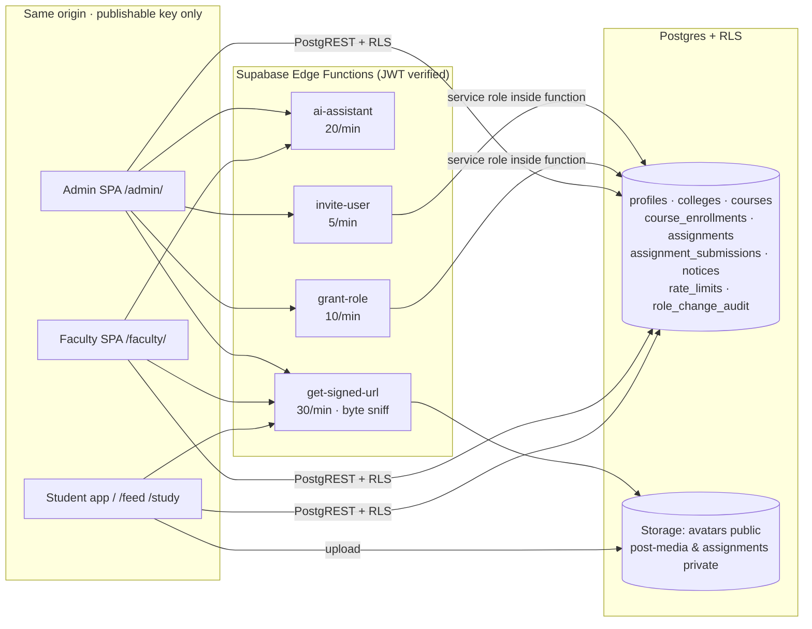
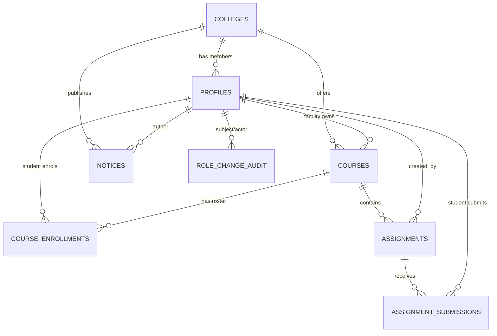

# CampusPulse demo runbook (PS-03)

Use this script to record the 3–5 minute hackathon walkthrough and to build the PPT
(ERD + architecture slides). It assumes the demo seed from the root README.

## 0. Before recording (5 minutes)

```bash
supabase start && supabase db reset
eval "$(supabase status -o env | sed -n '/^SUPABASE_URL=/p; /^SUPABASE_SERVICE_ROLE_KEY=/p')"
CAMPUSPULSE_ALLOW_DEMO_SEED=true node scripts/seed-demo-users.mjs
npm ci && npm run build:vercel
cd campuspulse-frontend
SUPABASE_URL="http://127.0.0.1:54321" SUPABASE_PUBLISHABLE_KEY="<local anon key>" \
  CAMPUSPULSE_DEMO_MODE=true node server.js
```

Open three browser profiles (or one profile + two private windows) at
`http://127.0.0.1:3000` so Student, Faculty and Admin sessions can coexist:

| Role | Entry | Credentials |
|---|---|---|
| Faculty | `/faculty/` | `faculty.demo@campuspulse.test` / `CampusPulse.Faculty!2026` |
| Student | `/login` | `student.demo@campuspulse.test` / `CampusPulse.Student!2026` |
| Admin | `/admin/` | `admin.demo@campuspulse.test` / `CampusPulse.Admin!2026` |

Keep DevTools → Network visible once to prove there are no 404 images and no
external requests.

## 1. Story arc (target 4:00)

| Time | Beat | What to show | What it proves |
|---|---|---|---|
| 0:00–0:20 | Problem | Landing page `/` | One origin, three role-specific experiences |
| 0:20–0:50 | Admin sets up the term | `/admin/` dashboard → KPI cards → `/admin/course-information` (live course + enrolment counts) → `/admin/student-records` → enrol the demo student | Admin-scoped RLS writes `course_enrollments`; the student cannot self-enrol |
| 0:50–1:30 | Faculty publishes | `/faculty/assignments`: create “AVL tree rotations lab”, due date, 100 points → `/faculty/courses`: publish a student notice | Faculty writes only to courses they own; notices are college+audience scoped |
| 1:30–2:20 | Student receives | `/feed`: “Live college notices” shows the notice just published → `/study`: enrolled courses + the new assignment with due date | Same rows, real UUIDs, RLS-scoped to the student's college |
| 2:20–3:00 | Student submits | `/study`: choose the assignment file (PDF) → Upload & submit → status flips to Submitted | Magic-byte + MIME/extension + size validation, private bucket write, submission row |
| 3:00–3:40 | Faculty grades | `/faculty/assignments`: submission appears → “Download file” (signed URL) → enter grade + feedback → Save grade | Signed URL issuance with ownership proof and byte sniffing; grading through RLS |
| 3:40–4:00 | Student sees the grade | `/study`: status becomes “Graded · 88/100” with feedback | Round-trip integrity |
| 4:00–4:20 | Governance close | `/admin/faculty-management`: role change via `grant-role` → audit; mention the AI workflow assistant | Audited privileged action, server-held keys |

Optional 20-second cutaway: `/faculty/workflow` — ask the assistant for a lesson
plan; show that it is advisory text only and no record changes.

## 2. Architecture slide



## 3. ERD slide (PS-03 core)



Key constraints worth naming on the slide: `courses(college_id, code, term)`
unique, `course_enrollments(course_id, student_id)` primary key,
`assignment_submissions(assignment_id, student_id)` unique, 25 MiB +
MIME allowlist + extension/MIME agreement, and `role_change_audit` written only
by trusted Edge code.

## 4. Talking points for judges

- **Authorization is in the database.** Every table has RLS; the browser only
  holds the publishable key. Service-role access exists only inside two Edge
  functions, and every privilege decision comes from `public.profiles`.
- **No self-promotion.** Signup defaults to student; role/college are not
  client-writable; invitations and role changes are audited and compensated on
  failure.
- **Private coursework is genuinely private.** Files live in a private bucket;
  reads are gated by a submission row, and downloads require a short-lived,
  server-verified signature after byte inspection.
- **Honest UI.** Modules without schema support are labelled sample rather than
  faking persistence; the demo never claims a write that did not happen.

## 5. PPT outline (10 slides)

1. Title + one-line pitch.
2. Problem statement PS-03 and who suffers (students, faculty, administration).
3. Solution overview screenshot collage (feed, faculty assignments, admin console).
4. Live workflow diagram (the six beats above).
5. Architecture slide (mermaid above).
6. ERD slide (mermaid above).
7. Security model: RLS matrix table (student / faculty / admin × table).
8. File-handling pipeline: browser sniff → bucket policy → DB constraints → signed URL sniff.
9. Evidence: `npm test` 65/65, build output, HTTP smoke results, migration list.
10. Roadmap + team + how to run locally.
