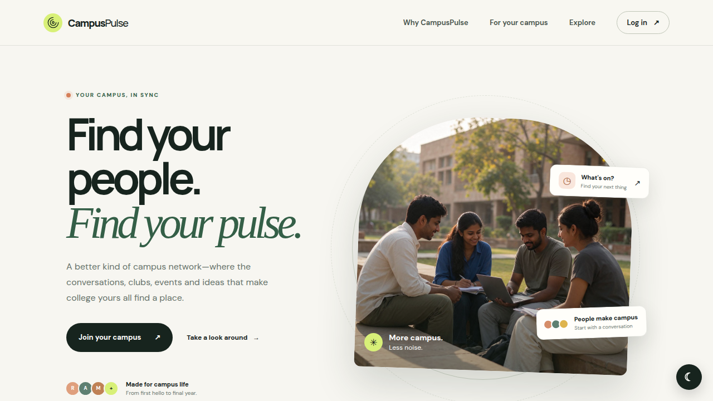

# CampusPulse repair and visual-review report

## What was fixed

- Faculty and Admin now support an explicit `?demo=1` review mode in production builds as well as Vite development. The mode creates no Supabase client, performs no Clerk sign-in, and keeps every live write behind the existing `live()` guard.
- The Admin demo course enrolment now uses the real sample student ID (`demo-student-1`), so the course count and student records agree.
- The local walkthrough now documents one combined build-and-serve command and same-origin URLs for Student, Faculty, and Admin.
- The repository's existing `manus-routes.json` remains the route discovery manifest for all portal areas.

## How to review locally

From the repository root:

```bash
npm ci
npm run build:vercel
PORT=3000 node campuspulse-frontend/server.js
```

Then open:

- Student: `http://127.0.0.1:3000/`
- Faculty demo: `http://127.0.0.1:3000/faculty/?demo=1`
- Admin demo: `http://127.0.0.1:3000/admin/?demo=1`

Representative nested routes are `/faculty/attendance?demo=1`, `/faculty/assignments?demo=1`, `/admin/student-records?demo=1`, and `/admin/faculty-management?demo=1`.

## Visual evidence

The Student landing page rendered successfully in the managed preview:



HTTP checks also returned 200 for Student, Faculty, Admin, nested Faculty/Admin routes, portal assets, `/api/config`, and `/manus-routes.json`. The managed screenshot/browser capture timed out on Faculty and Admin after the server and assets were proven healthy, so those two visual captures are intentionally **not claimed as verified** here. Use the preview URLs above to inspect them directly.

## Checks run

- `npm ci --no-audit --no-fund`
- `npm test`: 15 API tests and 62 security tests passed.
- `node --test tests/security/portal-auth.test.mjs`: 9 tests passed, including the new production-demo and demo-ID regression checks.
- `npm run build:vercel`: Student, Faculty, and Admin builds completed successfully.
- `git diff --check`: passed.
- Managed Webdev server: listening on port 3000; route and asset HTTP checks passed.

## Not verified

Live Clerk sign-in, live Supabase reads/writes, RLS behavior against a real project, and the final Faculty/Admin screenshot capture were not verified in this credential-free sandbox.
